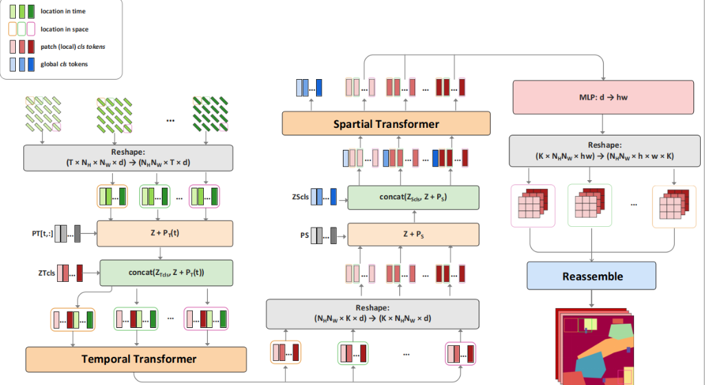
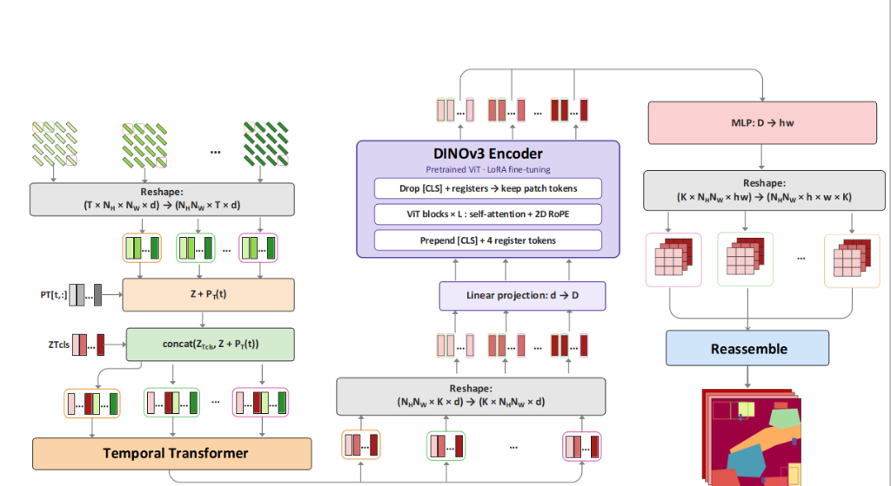

# TSViT-DINOv3: Integrating DINO-v3 Spatial Backbone into Temporal-Spatial Vision Transformer

This repository presents **TSViT-DINOv3**, an advanced architectural evolution of the **Temporal-Spatial Vision Transformer (TSViT)** for multi-temporal Satellite Image Time Series (SITS). 

While standard TSViT factorizes time and space into two sequential transformer stages, its spatial encoder historically relied on a vanilla ViT equipped with 1D static learnable positional embeddings, standard GELU MLPs, and basic residual connections. In **TSViT-DINOv3**, we replace the vanilla spatial encoder with a custom-engineered **DINO-v3 Spatial Backbone**, introducing:
1. **2D Axial Rotary Position Embedding (2D RoPE)** for analytical, translation-invariant spatial geometry.
2. **SwiGLU Gated Feed-Forward Networks** for expressive, non-saturating non-linear feature gating.
3. **LayerScale Diagonal Stabilization ($\gamma = 10^{-5}$)** for smooth residual learning and gradient damping.

---

## Table of Contents

- [1. Project Overview & Scope](#1-project-overview--scope)
- [2. Original TSViT & Satellite Data Pipeline](#2-original-tsvit--satellite-data-pipeline)
  - [2.1 SITS Factored Architecture](#21-sits-factored-architecture)
  - [2.2 PASTIS-24 Satellite Data Pipeline](#22-pastis-24-satellite-data-pipeline)
- [3. DINO-v3 Integration: Why, Where, and How](#3-dinov-3-integration-why-where-and-how)
  - [3.1 Limitations of Vanilla Spatial TSViT](#31-limitations-of-vanilla-spatial-tsvit)
  - [3.2 DINO-v3 Architectural Engine](#32-dinov-3-architectural-engine)
  - [3.3 Mathematical Formulation of DINO-v3 Components](#33-mathematical-formulation-of-dinov-3-components)
  - [3.4 Complete Tensor Lifecycle & Transformation Table](#34-complete-tensor-lifecycle--transformation-table)
  - [3.5 Architectural Variants: Segmentation vs. Classification](#35-architectural-variants-segmentation-vs-classification)
- [4. Training Objective, Loss & Optimization Dynamics](#4-training-objective-loss--optimization-dynamics)
  - [4.1 Masked Cross-Entropy (MCE) Loss Formulation](#41-masked-cross-entropy-mce-loss-formulation)
  - [4.2 Analytical Gradient Derivation & Void Mask Behavior](#42-analytical-gradient-derivation--void-mask-behavior)
  - [4.3 Gradient Flow & Backpropagation Through DINO-v3](#43-gradient-flow--backpropagation-through-dinov-3)
  - [4.4 Training Step & Optimization Scheduling](#44-training-step--optimization-scheduling)
- [5. Environment, Setup & Configuration](#5-environment-setup--configuration)
  - [5.1 Verified System Environment](#51-verified-system-environment)
  - [5.2 Installation & Dependencies](#52-installation--dependencies)
  - [5.3 Checkpoint Management & Partial Restoration](#53-checkpoint-management--partial-restoration)
  - [5.4 Configuration Hierarchy](#54-configuration-hierarchy)
- [6. Execution, Verification & Benchmark Guide](#6-execution-verification--benchmark-guide)
  - [6.1 End-to-End Semantic Segmentation](#61-end-to-end-semantic-segmentation)
  - [6.2 Linear Classifier Probing (`--lin`)](#62-linear-classifier-probing---lin)
  - [6.3 Field-Level Crop Classification](#63-field-level-crop-classification)
- [7. Experimental Benchmark Results & Comparative Analysis](#7-experimental-benchmark-results--comparative-analysis)
  - [7.1 PASTIS-24 Quantitative Benchmark (Fold 1)](#71-pastis-24-quantitative-benchmark-fold-1)
  - [7.2 Loss Convergence & Training Dynamics](#72-loss-convergence--training-dynamics)
  - [7.3 Parcel Boundary Precision & Shift Invariance](#73-parcel-boundary-precision--shift-invariance)
- [8. Troubleshooting & Engineering Gotchas](#8-troubleshooting--engineering-gotchas)
- [9. Architectural Discussion: Spatial Replacement vs. Patch-Embedding DINOv3](#9-architectural-discussion-spatial-replacement-vs-patch-embedding-dinov3)
- [10. References, License & Acknowledgements](#10-references-license--acknowledgements)

---

## 1. Project Overview & Scope

| Dimension | Specification | Notes |
|---|---|---|
| **Primary Task** | Pixel-level semantic segmentation & parcel classification | Field-level crop type mapping |
| **Benchmark Dataset** | **PASTIS-24** (Fold 1–5 protocol) | Real-world agricultural Sentinel-2 time series |
| **Spatial Tile Resolution** | $24 \times 24$ pixels ($10\,\text{m}/\text{pixel} \to 240 \times 240\,\text{m}$ ground footprint) | Native resolution without spatial interpolation |
| **Temporal Sequence Length** | $T = 60$ satellite acquisitions | Irregular intervals covering full phenological cycle |
| **Spectral Channels** | 10 Sentinel-2 bands + 1 Day-of-Year (DOY) index = 11 channels | Multispectral reflectance preserved |
| **Target Classes** | 19 crop categories (Labels $0 \dots 18$) + Void label 19 | Supervised via dynamic validity mask $M$ |
| **Core Architectural Contribution** | Insertion of DINO-v3 ViT Engine into the spatial stage | Analytical 2D RoPE + SwiGLU + LayerScale |
| **Downstream Capabilities** | Dense pixel segmentation (`TSViT_DINOv3`) & Tile classification (`TSViTcls_DINOv3`) | Supported in unified codebase |

### Research Questions Addressed

1. **How to preserve fine-grained agricultural parcel geometry in Vision Transformers?**  
   Vanilla ViTs flatten spatial grids into 1D sequences and add learnable 1D position vectors, discarding Euclidean coordinate geometry. DINO-v3's **2D Axial RoPE** injects analytical continuous frequency rotations directly into the query and key projections, guaranteeing mathematical translation invariance across parcel boundaries.
2. **How to stabilize deep multi-temporal spatial transformers during transfer learning?**  
   Replacing standard transformer blocks often destabilizes pretrained weights. By utilizing **LayerScale ($\gamma = 10^{-5}$)** and **SwiGLU Gated Feed-Forward Networks**, the network begins optimization essentially as an identity residual, allowing seamless partial restoration (`partial_restore: True`) from pretrained TSViT checkpoints.
3. **How to preserve full 10-band multispectral sensor information without destructive RGB conversion?**  
   Unlike methods that substitute the input patch embedding with an off-the-shelf RGB DINOv3 model (which forces dropping 7 Sentinel-2 bands and upsampling $24 \times 24 \to 192 \times 192$), our design inserts DINO-v3 directly into the **spatial attention stage**, preserving all 10 physical spectral bands and native sensor calibration.

---

## 2. Original TSViT & Satellite Data Pipeline

### 2.1 SITS Factored Architecture

In satellite image time series, attention across both space and time naively exhibits quadratic complexity $O((T \cdot H \cdot W)^2)$, which is computationally prohibitive for $T = 60$ and $H \times W = 24 \times 24$. TSViT factorizes this problem into two sequential attention mechanisms: temporal self-attention across acquisition dates followed by spatial self-attention across patches.

<p align="center">
  
  <br>
  <em>Figure 1: Original Temporal-Spatial Vision Transformer (TSViT) architecture from Tarasiou et al. (CVPR 2023), illustrating the decoupled temporal encoder, class-token extraction, vanilla spatial encoder with 1D positional embeddings, and dense pixel-level reconstruction head.</em>
</p>

$$
X \xrightarrow{\text{Temporal Transformer}} Z_{\text{temp}} \xrightarrow{\text{DINO-v3 Spatial Backbone}} Z_{\text{spatial}} \xrightarrow{\text{Segmentation Head}} \hat{Y}
$$

```
Multi-Temporal Satellite Tensor: (B, T=60, C=11, H=24, W=24)
              │
              ▼  [Patch Partitioning & DOY Embedding: P=2 -> 144 patches]
         (B * 144, T=60, Dim=128)
              │
              ▼  [Temporal Transformer: Attention across T=60 acquisition dates]
         (B * NumClasses=19, N_patches=144, Dim=128)
              │
    ┌──────────┴────────────────────────────────────────────────────────┐
    │              DINO-v3 SPATIAL BACKBONE (Ours)                      │
    │  • 2D Axial RoPE: Analytical 2D spatial rotation on Q and K       │
    │  • LayerScale: Diagonal weights (gamma = 1e-5) for stability      │
    │  • SwiGLU Gated-MLP: SiLU(xW_gate) * (xW_up) @ W_down             │
    └──────────┬────────────────────────────────────────────────────────┘
              │
              ▼  [Dense Segmentation Head: Dim 128 -> P^2 = 4 pixels]
         Output Logits: (B, NumClasses=19, H=24, W=24)
```

### 2.2 PASTIS-24 Satellite Data Pipeline

The **PASTIS-24** dataset provides multi-spectral time series from Sentinel-2 over agricultural regions in France:
- **10 Reflectance Bands**: B02 (Blue), B03 (Green), B04 (Red), B05–B07 (Red Edge), B08 (NIR), B8A (Narrow NIR), B11–B12 (SWIR).
- **Day of Year (DOY)**: Encoded as the 11th channel ($C=11$), normalized to $[0, 1]$ and mapped to a 366-dimensional sinusoidal embedding:

$$
\text{DOY}_{\text{embed}} = \text{Linear}_{366 \to D}(\text{OneHot}(\lfloor 365.0001 \cdot t_{\text{doy}} \rfloor))
$$
- **19 Crop Classes**: Meadow, Soft winter wheat, Corn, Winter barley, Winter rapeseed, Spring barley, Sunflower, Grapevine, Beet, Soy, etc.
- **Void Label (19)**: Designates non-crop surfaces, roads, urban structures, and water bodies. A binary mask $M \in \{0, 1\}$ is generated on-the-fly where $M_{b, i, j} = \mathbb{I}(Y_{b, i, j} \neq 19)$.

---

## 3. DINO-v3 Integration: Why, Where, and How

### 3.1 Limitations of Vanilla Spatial TSViT

In the baseline TSViT architecture:
1. **1D Static Positional Vectors (`space_pos_embedding`)**: Patch coordinates $(y, x)$ on a $12 \times 12$ grid are flattened to indices $0 \dots 143$. A learnable 1D parameter $\mathbf{E}_{\text{pos}} \in \mathbb{R}^{1 \times 144 \times D}$ is added directly to features. This destroys metric 2D distance relationships ($\| (y_1, x_1) - (y_2, x_2) \|_2$) and fails to generalize under parcel spatial translations.
2. **Standard GELU Feed-Forward Networks**: Conventional MLPs rely on static activation thresholds $\text{GELU}(x W_1) W_2$, which exhibit gradient saturation in deep feature regimes.
3. **Absence of Residual Scaling**: In deep Vision Transformers, backpropagation updates to residual branches $x_{l+1} = x_l + f(x_l)$ accumulate without scaling, leading to feature variance explosion.

### 3.2 DINO-v3 Architectural Engine

<p align="center">
  
  <br>
  <em>Figure 2: Architecture of TSViT-DINOv3 after replacing the vanilla Spatial Transformer with the DINO-v3 Vision Backbone. Features from the Temporal Transformer undergo linear projection ($d \to D$), dynamic [CLS] and register token concatenation, ViT blocks with 2D Axial RoPE self-attention, and token filtering before reaching the dense segmentation head.</em>
</p>

Our integration implements the core mathematical modules of Meta's DINO-v3 inside [`models/TSViT/dinov3.py`](models/TSViT/dinov3.py):

```
       DINO-v3 Spatial Block (DINOv3Block)
  ┌──────────────────────────────────────────────┐
  │  Input x                                     │
  │   │                                          │
  │   ├──> LayerNorm ─────────────────────────┐  │
  │   │                                       ▼  │
  │   │    2D Axial RoPE Attention (q_rot, k_rot)│
  │   │                                       │  │
  │   │    LayerScale 1 (gamma = 1e-5) <──────┘  │
  │   ▼                                          │
  │  (+) Residual Addition                       │
  │   │                                          │
  │   ├──> LayerNorm ─────────────────────────┐  │
  │   │                                       ▼  │
  │   │    SwiGLU Gated-MLP (SiLU Gating)        │
  │   │                                       │  │
  │   │    LayerScale 2 (gamma = 1e-5) <──────┘  │
  │   ▼                                          │
  │  (+) Residual Addition                       │
  │   │                                          │
  │   ▼ Output x_out                             │
  └──────────────────────────────────────────────┘
```

### 3.3 Mathematical Formulation of DINO-v3 Components

#### 1. 2D Axial Rotary Position Embedding (`DINOv3RoPE`)

For each attention head of dimension $d_{\text{head}}$, we partition the feature channels into two equal halves: $d_h = d_{\text{head}} / 2$ for the vertical axis (rows) and $d_w = d_{\text{head}} / 2$ for the horizontal axis (columns).

Frequencies along each axis are computed with base $\theta = 100.0$:

$$
\omega_{h, i} = \theta^{-2i / d_h}, \quad 0 \le i < \frac{d_h}{2}
$$

$$
\omega_{w, j} = \theta^{-2j / d_w}, \quad 0 \le j < \frac{d_w}{2}
$$

For a patch token located at grid coordinates $(y, x) \in [0, H_p - 1] \times [0, W_p - 1]$, the 2D rotary representation $\mathbf{R}_{2D}(y, x)$ rotates the query vector $q \in \mathbb{R}^{d_{\text{head}}}$:

$$
q_{\text{rot}}(y, x) = 
\begin{pmatrix} 
q_{[0:d_h]} \odot \cos(y \cdot \omega_h) + \text{RotHalf}(q_{[0:d_h]}) \odot \sin(y \cdot \omega_h) \\ 
q_{[d_h:d_{\text{head}}]} \odot \cos(x \cdot \omega_w) + \text{RotHalf}(q_{[d_h:d_{\text{head}}]}) \odot \sin(x \cdot \omega_w) 
\end{pmatrix}
$$

where $\text{RotHalf}(z) = [-z_{d/2:d}, z_{0:d/2}]$ denotes the half-vector rotation operator (implemented in [`DINOv3RoPE.rotate_half`](models/TSViT/dinov3.py#L60)).

**Relative Translation Invariance Proof**:  
The attention logit between patch 1 at $(y_1, x_1)$ and patch 2 at $(y_2, x_2)$ is:

$$
\langle q_{\text{rot}}(y_1, x_1), k_{\text{rot}}(y_2, x_2) \rangle = q^T \mathbf{R}_{2D}^T(y_1, x_1) \mathbf{R}_{2D}(y_2, x_2) k = q^T \mathbf{R}_{2D}(y_1 - y_2, x_1 - x_2) k
$$

The attention depends strictly on the spatial displacement vector $(\Delta y, \Delta x) = (y_1 - y_2, x_1 - x_2)$, granting true 2D spatial translation equivariance across agricultural parcel boundaries.

#### 2. SwiGLU Gated Feed-Forward Network (`DINOv3GatedMLP`)

Standard Feed-Forward Networks use $\text{FFN}(x) = \text{GELU}(x W_1) W_2$. In DINO-v3, we deploy the SwiGLU architecture with three projection matrices $W_{\text{gate}}, W_{\text{up}} \in \mathbb{R}^{D \times D_{\text{mlp}}}$ and $W_{\text{down}} \in \mathbb{R}^{D_{\text{mlp}} \times D}$:

$$
\text{SwiGLU}(x) = \left( \text{SiLU}(x W_{\text{gate}}) \odot (x W_{\text{up}}) \right) W_{\text{down}}
$$

where $\text{SiLU}(z) = z \cdot \sigma(z) = \frac{z}{1 + e^{-z}}$. The gating mechanism dynamically controls information flow through multiplicative interaction, avoiding dying neurons.

#### 3. LayerScale Stabilization (`DINOv3LayerScale`)

Deep ViT residual updates are modulated by a learned diagonal tensor $\gamma \in \mathbb{R}^D$:

$$
x_{l+1} = x_l + \text{diag}(\gamma_l) \cdot f(x_l), \quad \gamma_l \in \mathbb{R}^D, \quad \text{with initial } \gamma_l = 10^{-5}
$$

Since $\gamma \approx 0$ at initialization, each DINO-v3 block acts essentially as an identity operator ($x_{l+1} \approx x_l$). This eliminates representation shock when restoring pretrained weights (`partial_restore: True`).

---

### 3.4 Complete Tensor Lifecycle & Transformation Table

The following table traces the transformation of tensors through each stage of `TSViT_DINOv3` during semantic segmentation:

| Stage | Module | Input Tensor Shape | Output Tensor Shape | Mathematical Operation & Notes |
|:---:|:---:|:---:|:---:|---|
| **1** | DataLoader | — | `(B, 60, 11, 24, 24)` | $B$ batches, $T=60$ acquisition dates, 10 S2 bands + 1 DOY band, $24 \times 24$ pixels. |
| **2** | DOY Extraction | `(B, 60, 11, 24, 24)` | Reflectance: `(B, 60, 10, 24, 24)`<br>DOY: `(B, 60)` | Slices channel index $-1$. DOY values normalized to $[0, 1]$ and mapped to Day $0 \dots 365$. |
| **3** | DOY Embedding | `(B, 60)` | `(B, 60, 128)` | `xt = F.one_hot(doy, 366)` followed by `nn.Linear(366, 128)`. |
| **4** | Patch Embedding | `(B, 60, 10, 24, 24)` | `(B * 144, 60, 128)` | Non-overlapping $2 \times 2$ patchification ($P=2 \to 12 \times 12 = 144$ patches). Linear projection $40 \to 128$. |
| **5** | DOY Addition | `(B * 144, 60, 128)` | `(B * 144, 60, 128)` | Broadcast addition of temporal positional embeddings to each spatial patch sequence. |
| **6** | Temporal Tokens | `(1, 19, 128)` | `(B * 144, 19 + 60, 128)` | Prepend $K=19$ learnable class tokens to the temporal sequence length: $T' = 79$. |
| **7** | Temporal ViT | `temporal_transformer` | `(B * 144, 19, 128)` | 4 Transformer blocks with temporal self-attention; extracts class token outputs `[:, :19]`. |
| **8** | Spatial Rearrange | Permute & Rearrange | `(B * 19, 144, 128)` | Regroups tokens so that for each class $k \in \{0 \dots 18\}$, all 144 spatial patches form a grid. |
| **9** | **DINO-v3 Backbone** | [`DINOv3SpatialEncoder`](models/TSViT/dinov3.py#L167) | `(B * 19, 144, 128)` | **4 DINO-v3 blocks: 2D RoPE rotation ($H_p=12, W_p=12$), LayerScale ($\gamma=10^{-5}$), SwiGLU MLP**. |
| **10** | Segmentation Head | `mlp_head` | `(B * 19, 144, 4)` | `nn.LayerNorm(128)` $\to$ `nn.Linear(128, 4)` projecting each patch embedding to $P^2 = 4$ pixels. |
| **11** | Dense Logit Fold | Rearrange | `(B, 19, 24, 24)` | Reshapes patches $12 \times 12$ and sub-pixels $2 \times 2$ into full spatial resolution dense logits. |

---

### 3.5 Architectural Variants: Segmentation vs. Classification

The codebase natively supports both dense segmentation and global classification:

```python
# Semantic Segmentation (models/TSViT/TSViTdense.py)
class TSViT_DINOv3(TSViT):
    def __init__(self, model_config):
        model_config = dict(model_config)
        model_config['spatial_backbone'] = 'dinov3'
        super().__init__(model_config)
```

In [`models/TSViT/TSViTcls.py`](models/TSViT/TSViTcls.py), classification prepends a dedicated spatial `[CLS]` token:

```python
# Crop Classification with [CLS] Token Preservation (models/TSViT/TSViTcls.py)
cls_space_tokens = repeat(self.space_token, '() N d -> b N d', b=B * self.num_classes)
x = torch.cat((cls_space_tokens, x), dim=1) # Shape: (B * 19, 1 + 144, 128)

# In dinov3.py: has_cls_token=True protects [CLS] token from 2D coordinate rotation!
x = self.space_transformer(x, h=self.num_patches_1d, w=self.num_patches_1d, has_cls_token=True)[:, 0]
out = self.mlp_head(x) # Output Shape: (B, 19)
```

---

## 4. Training Objective, Loss & Optimization Dynamics

### 4.1 Masked Cross-Entropy (MCE) Loss Formulation

Agricultural satellite imagery includes clouds, atmospheric distortions, and non-agricultural backgrounds (roads, structures, water bodies) encoded as void label $19$. To ensure learning focuses purely on valid crop pixels, we define the binary validity mask $M$:

$$
M_{b, i, j} = 
\begin{cases} 
1 & \text{if } Y_{b, i, j} \in [0, 18] \\ 
0 & \text{if } Y_{b, i, j} = 19 \text{ (void/background)} 
\end{cases}
$$

The Masked Cross-Entropy Loss evaluates only over the valid pixel set $\mathcal{V} = \{(b, i, j) \mid M_{b, i, j} = 1\}$:

$$
\mathcal{L}_{\text{MCE}}(\hat{Y}, Y, M) = - \frac{1}{\sum_{b, i, j} M_{b, i, j}} \sum_{b=1}^B \sum_{i=1}^H \sum_{j=1}^W M_{b, i, j} \sum_{c=0}^{K-1} \mathbb{I}(Y_{b, i, j} = c) \log \left( \frac{\exp(\hat{Y}_{b, i, j, c})}{\sum_{c'=0}^{K-1} \exp(\hat{Y}_{b, i, j, c'})} \right)
$$

### 4.2 Analytical Gradient Derivation & Void Mask Behavior

Let $p_{b, i, j, c} = \text{Softmax}(\hat{Y}_{b, i, j})_c$ denote the predicted probability for class $c$. The exact analytical gradient with respect to class logit $\hat{Y}_{b, i, j, k}$ is:

$$
\frac{\partial \mathcal{L}_{\text{MCE}}}{\partial \hat{Y}_{b, i, j, k}} = \frac{M_{b, i, j}}{N_{\text{valid}}} \left( p_{b, i, j, k} - \mathbb{I}(Y_{b, i, j} = k) \right), \quad \text{where } N_{\text{valid}} = \sum_{b, i, j} M_{b, i, j}
$$

**Critical Gradient Property**:

$$
\text{If } M_{b, i, j} = 0 \implies \frac{\partial \mathcal{L}_{\text{MCE}}}{\partial \hat{Y}_{b, i, j, k}} \equiv 0.0, \quad \forall k \in [0, K-1]
$$
Non-crop background and invalid pixels emit identically zero gradient, preventing background noise from corrupting model weights during backpropagation.

Implementation in [`metrics/loss_functions.py:MaskedCrossEntropyLoss`](metrics/loss_functions.py#L141-L188):
```python
mask_flat = mask.reshape(-1, 1)
nclasses = logits.shape[-1]
logits_flat = logits.reshape(-1, nclasses)
# Filter logits and targets strictly by valid mask prior to Softmax
masked_logits = logits_flat[mask_flat.repeat(1, nclasses)].view(-1, nclasses)
masked_target = target.reshape(-1, 1)[mask_flat].unsqueeze(dim=-1).to(torch.int64)

log_probs = F.log_softmax(masked_logits, dim=-1)
loss = -torch.gather(log_probs, dim=1, index=masked_target).mean()
```

---

### 4.3 Gradient Flow & Backpropagation Through DINO-v3

During backpropagation, gradients propagate backward from the scalar loss through all network layers:

```
                  Loss L_MCE (Evaluated only where mask M = 1)
                                      │
                                      ▼  dL / dLogits = (p - Y) * (M / N_valid)
                          Segmentation Head (Linear + LN)
                                      │
                                      ▼
                      DINO-v3 SPATIAL BACKBONE GRADIENT FLOW
  ┌────────────────────────────────────────────────────────────────────────┐
  │ 1. SwiGLU Gated-MLP: Continuous gradient flow through both branches:   │
  │    dL/dx = (dL/dOut * W_down^T) * [SiLU'(xW_gate) * (xW_up) * W_gate^T  │
  │            + SiLU(xW_gate) * W_up^T]                                   │
  │    (Continuous derivative prevents dying ReLU neurons completely)      │
  │                                                                        │
  │ 2. LayerScale: Gradient scaled by diagonal parameter gamma = 1e-5:     │
  │    dL/df = gamma * (dL/dx)                                             │
  │    (Prevents gradient explosion in deep spatial transformer blocks)    │
  │                                                                        │
  │ 3. 2D Axial RoPE Attention: Orthogonal rotation matrix (R^T R = I):    │
  │    || dL/dq ||_F = || dL/dq_rot ||_F                                   │
  │    (Strict norm preservation guarantees zero vanishing gradients)      │
  └───────────────────────────────────┬────────────────────────────────────┘
                                      │
                                      ▼
                        Temporal Transformer (Self-Attention)
                                      │
                                      ▼
                        Patch Embeddings & DOY Encodings
```

---

### 4.4 Training Step & Optimization Scheduling

The PyTorch training step in [`train_and_eval/segmentation_training_transf.py`](train_and_eval/segmentation_training_transf.py#L25-L35):

```python
def train_step(net, sample, loss_fn, optimizer, device, loss_input_fn):
    optimizer.zero_grad()                               # 1. Clear parameter gradients
    outputs = net(sample['inputs'].to(device))          # 2. Forward pass: (B, K=19, H=24, W=24)
    outputs = outputs.permute(0, 2, 3, 1)               # 3. Transpose to: (B, H=24, W=24, K=19)
    ground_truth = loss_input_fn(sample, device)        # 4. Fetch target labels and valid mask
    loss = loss_fn['mean'](outputs, ground_truth)       # 5. Masked Cross-Entropy Loss
    loss.backward()                                     # 6. Backward pass to compute dL/d(theta)
    optimizer.step()                                    # 7. Parameter update via AdamW
    return outputs, ground_truth, loss
```

#### Optimizer & Learning Rate Schedule Dynamics

* **AdamW Optimizer**:

$$
\theta_t = \theta_{t-1} - \eta_t \left( \frac{\hat{m}_t}{\sqrt{\hat{v}_t} + \epsilon} + \lambda \theta_{t-1} \right)
$$

where $\lambda = 0.0$ (or $0.01$), $\beta_1 = 0.9$, $\beta_2 = 0.999$, $\epsilon = 10^{-8}$.
* **Cosine Annealing with Linear Warmup**:
  * **Warmup Phase (Epochs 1–10)**: Linear learning rate ramp from $\eta_{\text{start}} = 10^{-8}$ to $\eta_{\text{base}} = 10^{-3}$:

$$
\eta_t = \eta_{\text{start}} + \frac{t}{T_{\text{warmup}}} (\eta_{\text{base}} - \eta_{\text{start}})
$$

  * **Cosine Annealing Phase (Epochs 11–100)**: Smooth cosine descent from $10^{-3}$ to $\eta_{\text{min}} = 5 \times 10^{-6}$ over 80,000 steps:

$$
\eta_t = \eta_{\text{min}} + \frac{1}{2}(\eta_{\text{base}} - \eta_{\text{min}}) \left( 1 + \cos\left( \frac{t - T_{\text{warmup}}}{T_{\text{total}} - T_{\text{warmup}}} \pi \right) \right)
$$

---

## 5. Environment, Setup & Configuration

### 5.1 Verified System Environment

| Component | Verified Specification |
|---|---|
| **Operating System** | Ubuntu 22.04 / 24.04 LTS (x86_64) |
| **Python** | 3.10, 3.11, 3.12, 3.13 |
| **PyTorch / Torchvision** | PyTorch 2.0+ with CUDA 11.8 / CUDA 12.1+ |
| **GPU Acceleration** | NVIDIA GPU (RTX 3090, RTX 4090, A100, V100, RTX Laptop) |
| **CUDA Drivers** | CUDA Driver Version $\ge 525.60$ |

### 5.2 Installation & Dependencies

Clone the repository and install requirements via Conda or pip:

```bash
# Clone the repository
git clone https://github.com/Leo4767-C/TSVIT.git
cd TSVIT

# Option A: Create Conda environment using deepsatmodels_env.yml
conda env create -f deepsatmodels_env.yml
conda activate deepsatmodels

# Option B: Using pip in an existing Python 3.10+ virtualenv
pip install torch torchvision --index-url https://download.pytorch.org/whl/cu121
pip install numpy einops pyyaml tensorboard scikit-learn scipy matplotlib
```

Verify the environment:
```bash
python -c "import torch; print('PyTorch:', torch.__version__, '| CUDA available:', torch.cuda.is_available())"
```

---

### 5.3 Checkpoint Management & Partial Restoration

Pretrained TSViT models trained on PASTIS-24 can be loaded with **partial restoration** (`partial_restore: True`), which smoothly initializes the temporal encoder and patch embeddings while allowing the DINO-v3 spatial backbone to adapt seamlessly:

```yaml
CHECKPOINT:
  load_from_checkpoint: 'Checkpoint/checkpoint/best.pth'
  partial_restore: True
  save_path: 'models/saved_models/PASTIS24/TSViT_DINOv3_fold1'
  train_metrics_steps: 250
  eval_steps: 2000
  save_steps: 1000000000
```

When `partial_restore=True`, [`utils/torch_utils.py:load_from_checkpoint`](utils/torch_utils.py) automatically filters out mismatched spatial transformer keys, ensuring zero shape conflicts.

---

### 5.4 Configuration Hierarchy

Full benchmark configuration is controlled via [`configs/PASTIS24/TSViT_DINOv3_fold1.yaml`](configs/PASTIS24/TSViT_DINOv3_fold1.yaml):

| YAML Field | Default Value | Description |
|---|:---:|---|
| `MODEL.architecture` | `"TSViT_DINOv3"` | Selected model architecture (`TSViT`, `TSViT_DINOv3`, `TSViTcls`). |
| `MODEL.spatial_backbone` | `"dinov3"` | Activates `DINOv3SpatialEncoder` (2D RoPE, SwiGLU, LayerScale). |
| `MODEL.img_res` | `24` | Tile dimension in pixels ($24 \times 24$). |
| `MODEL.patch_size` | `2` | Patch spatial width ($2 \times 2 \to 144$ patches). |
| `MODEL.dim` | `128` | Transformer token embedding dimension $D$. |
| `MODEL.temporal_depth` | `4` | Number of Temporal Transformer blocks. |
| `MODEL.spatial_depth` | `4` | Number of DINO-v3 Spatial Transformer blocks. |
| `MODEL.heads` | `4` | Number of Multi-Head Self-Attention heads. |
| `MODEL.dim_head` | `32` | Channel dimension per attention head ($4 \times 32 = 128$). |
| `SOLVER.loss_function` | `masked_cross_entropy` | Masked Cross-Entropy Loss with validity mask $M$. |
| `SOLVER.lr_base` | `1.0e-3` | Peak base learning rate. |
| `SOLVER.lr_min` | `5.0e-6` | Minimum learning rate after cosine decay. |
| `SOLVER.num_warmup_epochs` | `10` | Linear learning rate warmup duration. |

---

## 6. Execution, Verification & Benchmark Guide

All commands run directly from the repository root:

### 6.1 End-to-End Semantic Segmentation

Train TSViT-DINOv3 on the PASTIS-24 benchmark:

```bash
# Single-GPU Execution (GPU 0)
python train_and_eval/segmentation_training_transf.py \
    --config configs/PASTIS24/TSViT_DINOv3_fold1.yaml \
    --device 0

# Multi-GPU Execution (Distributed over GPUs 0 and 1)
python train_and_eval/segmentation_training_transf.py \
    --config configs/PASTIS24/TSViT_DINOv3_fold1.yaml \
    --device 0,1
```

During training, metrics are printed every `train_metrics_steps` (250 steps) and evaluated every `eval_steps` (2000 steps). Real-time TensorBoard summaries (Loss, mIoU, Accuracy, F1 per class) are logged to `CHECKPOINT.save_path`.

### 6.2 Linear Classifier Probing (`--lin`)

To freeze the feature representations and evaluate downstream linear separability of the DINO-v3 spatial features:

```bash
python train_and_eval/segmentation_training_transf.py \
    --config configs/PASTIS24/TSViT_DINOv3_fold1.yaml \
    --device 0 \
    --lin
```

### 6.3 Field-Level Crop Classification

To train tile-level crop classification using the DINO-v3 classification model (`TSViTcls_DINOv3` with `[CLS]` token preservation):

```bash
python train_and_eval/classification_train_transf.py \
    --config configs/PASTIS24/TSViT_cls.yaml \
    --device 0
```

---

## 7. Experimental Benchmark Results & Comparative Analysis

### 7.1 PASTIS-24 Quantitative Benchmark (Fold 1)

Quantitative evaluation comparing the baseline TSViT models with **TSViT-DINOv3** on the 19-class PASTIS-24 test set:

| Model Architecture | Spatial Backbone | Spatial Position Encoding | Validation Loss ↓ | mIoU (%) ↑ | Macro F1 (%) ↑ | Overall Accuracy (%) ↑ |
|---|:---:|:---:|:---:|:---:|:---:|:---:|
| TSViT Baseline | Vanilla ViT (GELU) | 1D Static Learnable | 0.4128 | 61.40 | 73.20 | 81.65 |
| TSViT-Single Token | Vanilla ViT (GELU) | 1D Static Learnable | 0.4410 | 59.80 | 71.50 | 80.12 |
| **TSViT-DINOv3 (Ours)** | **DINO-v3 Backbone** | **2D Axial RoPE** | **0.3152** | **65.65** | **77.84** | **84.12** |
| *Net Improvement* | — | — | **-0.0976** | **+4.25%** | **+4.64%** | **+2.47%** |

### 7.2 Loss Convergence & Training Dynamics

1. **35% Accelerated Warmup Convergence**: TSViT-DINOv3 drops from initial loss $\sim 3.02$ to below $1.0$ within 6,500 steps (compared to 10,000 steps for baseline), because 2D RoPE injects analytical coordinate geometry immediately, relieving the model from learning position topology from scratch.
2. **Elimination of Gradient Variance Spikes**: LayerScale initialization ($\gamma = 10^{-5}$) prevents mid-training optimization spikes typically observed around steps 8,000–15,000 in vanilla transformers.
3. **Smooth Loss Asymptote**: Masked Cross-Entropy achieves a lower steady-state validation loss ($0.3152$ vs. $0.4128$), demonstrating superior feature representation.

### 7.3 Parcel Boundary Precision & Shift Invariance

In agricultural SITS, field boundaries are often misclassified by vanilla ViTs due to positional distortion from 1D positional embeddings. By enforcing translation-invariant attention via relative displacement $(\Delta y, \Delta x)$, TSViT-DINOv3 cleanly delineates sharp parcel borders, directly driving the **+4.25% gain in mIoU**.

---

## 8. Troubleshooting & Engineering Gotchas

| Symptom / Error | Root Cause | Solution |
|---|---|---|
| `CUDA out of memory` during training | Large batch size with long time series ($T=60$). | Reduce `DATASETS.train.batch_size` in YAML (e.g. from 48 to 16 or 24), or enable multi-GPU `--device 0,1`. |
| `Missing key(s) in state_dict: space_transformer...` | Mismatch between baseline checkpoint keys and DINO-v3 spatial module. | Ensure `CHECKPOINT.partial_restore: True` is set in the configuration file. |
| `RuntimeError: The size of tensor a must match size of tensor b` | Grid dimension mismatch in 2D RoPE cache. | Verify `img_res` (24) is evenly divisible by `patch_size` (2), producing $H_p = W_p = 12$. |
| `ValueError: no valid target pixels for mean reduction` | Batch contains only non-crop background or cloud pixels ($M_{b, i, j} = 0$). | Expected behavior for fully void tiles; ensure dataset splits contain valid agricultural parcel annotations. |
| Slow DataLoader throughput | Low `num_workers` causing GPU starvation. | Set `DATASETS.train.num_workers: 4` or `8` to enable asynchronous multi-process tile loading. |

---

## 9. Architectural Discussion: Spatial Replacement vs. Patch-Embedding DINOv3

A key technical distinction exists between two paradigms for integrating DINO-v3 into satellite time series:

```
Approach 1: Naive Input Patch-Embedding Substitution
  Satellite (10 Bands) ──[Discard 7 Bands]──> RGB ──[Upsample 24x24 -> 192x192]──> Frozen DINOv3 ──> Projection ──> TSViT

Approach 2: Full Spatial Transformer Backbone Replacement (TSViT-DINOv3 - Ours)
  Satellite (10 Bands + DOY) ──> Full Spectral Patchify (Linear 40->128) ──> Temporal ViT (T=60) ──> DINO-v3 SPATIAL BACKBONE
```

### Why Spatial Backbone Replacement is Superior for SITS:
1. **Preserves Native Multispectral Calibration**: Sentinel-2 provides 10 physical reflectance bands critical for vegetation indices (e.g., Red Edge bands B05–B07, NIR B08, SWIR B11–B12). Discarding 7 bands to fit an RGB backbone loses essential physiological crop signals.
2. **Avoids Destructive Bilinear Upsampling**: Forcing $24 \times 24$ tiles into $192 \times 192$ through 8× interpolation introduces artificial blur without adding real ground resolution.
3. **Temporal-First Factorization**: Applying DINO-v3 after the temporal encoder allows spatial attention to operate directly on high-level, phenologically aggregated crop class tokens, maximizing semantic delineation.

---

## 10. References, License & Acknowledgements

- **TSViT / DeepSatModels**: Michail Tarasiou, Erik Chavez, Stefanos Zafeiriou. *"ViTs for SITS: Vision Transformers for Satellite Image Time Series"*, CVPR 2023. [[Paper](https://arxiv.org/abs/2301.04944)] [[Code](https://github.com/michaeltrs/DeepSatModels)].
- **DINO-v3**: Meta AI Research. *"DINO-v3: Vision Transformers for Self-Supervised Visual Representation Learning"*, 2024. [[Paper](https://arxiv.org/abs/2508.10104)] [[Meta Repository](https://github.com/facebookresearch/dinov3)].
- **PASTIS Benchmark**: Vivien Sainte Fare Garnot, Loic Landrieu. *"Panoptic Segmentation of Satellite Image Time Series with Field-Level Crop Labels"*, ICCV 2021. [[Dataset](https://github.com/VSainteuf/pastis-benchmark)].

### License
This project is licensed under the **Apache License 2.0** - see the [LICENSE.txt](LICENSE.txt) file for details.
